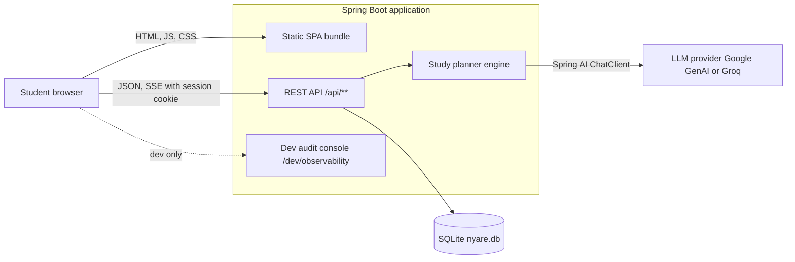
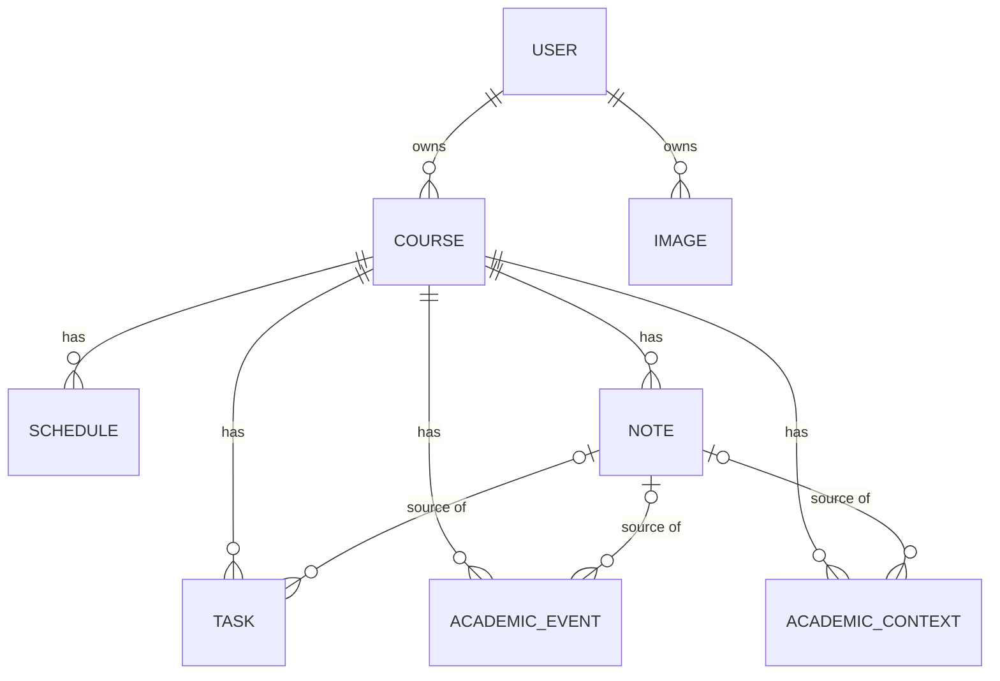
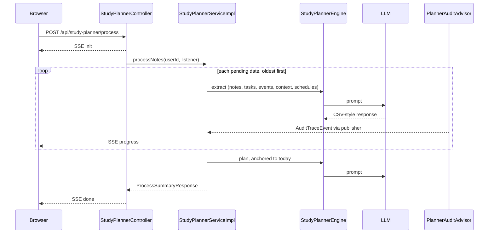
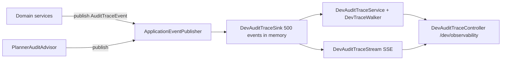

# Nyare Architecture Specification

This document describes the architecture of Nyare from the browser to the database. Domain meaning lives in `conceptual-model.md` and `system-workflows.md`. Scope limits live in `mvp-boundaries.md`. Implementation rules live in `app/docs/conventions.md`.

---

## 1. System Context

Nyare is a calendar-first academic planner. One Spring Boot application serves both the REST API and the compiled Vue single-page application (SPA).



| Concern | Choice |
|---|---|
| App runtime | Java 25, Spring Boot 4.1.1, Gradle |
| Persistence | JPA / Hibernate on SQLite (`nyare.db`) |
| AI integration | Spring AI 2.0.0 (`google-genai` or `openai` with Groq base URL) |
| Frontend | Vue 3, Vite, TypeScript, Tailwind 4 |
| Deployment unit | One JAR. Vite writes the bundle to `app/src/main/resources/static`. |
| Identity | Passwordless account picker with a server-side HTTP session |

---

## 2. Repository Layout

| Path | Content |
|---|---|
| `app/` | Spring Boot service. Base package `group.four.nyare.nyare`. |
| `app/src/main` | Production code and resources. |
| `app/src/dev` | Dev-only source set. Holds the audit trace console, `dev.sql`, and `application-dev.properties`. |
| `app/src/test` | JUnit 5 tests. Tests also compile against `src/dev` output. |
| `frontend/` | Vue SPA. Alias `@` maps to `src/`. |
| `docs/` | Domain truth and this specification. |
| `docs/deliberations/` | Submission deliverables. Not engineering truth. |
| `specs/` | Per-feature specification kits. |
| `DESIGN.md` | UI/UX design system. |

---

## 3. Backend Architecture

### 3.1 Layers

```text
Controller  (@RestController, /api/...)        DTOs in, DTOs out
   ↓ calls interface
Service     (interface in service, impl in service.impl)   @Transactional, mapping, ownership scoping
   ↓
Repository  (Spring Data JPA)
   ↓
SQLite
```

- Controllers never touch repositories. Entities never leave the service layer.
- Services use class-level `@Transactional(readOnly = true)`. Mutating methods add an explicit `@Transactional`.
- Subpackages are lowercase.

### 3.2 Packages

| Package | Role |
|---|---|
| `controller` | REST endpoints, `GlobalExceptionHandler` (RFC 7807), `SpaController`. |
| `service`, `service.impl` | Business logic. `StudyPlannerService` orchestrates processing. |
| `repository` | JPA repositories and read projections such as `ImageMetadataView`. |
| `model`, `model.enums` | JPA entities, `TaskStatus`, `PlanCategory`. |
| `dto` | Request and response records. |
| `exception` | `ResourceNotFoundException` (404) and `BadRequestException` (400) only. |
| `config` | `SessionInterceptor`, `SessionContext`, `WebConfig`, `StartupInfoListener`. |
| `ai` | `StudyPlannerEngine`, `ImageAiProcessor`, `PlannerResponseRecords`. |
| `ai.parser` | `CsvParser`, `StubReferenceCodec`, `TitleSimilarityMatcher`. |
| `ai.prompt` | `TaggedPromptBuilder`. |
| `ai.observability` | `PlannerAuditAdvisor` and audit event types. Ships in the production JAR. |
| `observability` (dev source set) | Audit console controller, service, sink, stream, walker, DTOs. |

### 3.3 Domain Model



- `Course` cascades to its children with `orphanRemoval`. `User` cascades to `Course`.
- `Task`, `AcademicEvent`, and `AcademicContext` hold an optional link to the source `Note`.
- `Image` belongs to a `User`. Notes reference images by identifier in their JSON content.
- **`StudyPlan` is virtual.** It has no table. The state of each `Task` is derived:
  - `SCHEDULED`: has `scheduledDate`.
  - `LATER`: no date and has `duration`.
  - `BACKLOG`: neither.

### 3.4 REST Surface

| Base path | Purpose |
|---|---|
| `/api/users` | List, create, login, logout, `me`. Open by design (PoC). |
| `/api/courses` | CRUD plus `archive`, `unarchive`, `archive-all`. |
| `/api/schedules` | Weekly class meeting times. |
| `/api/notes` | Course-linked journal entries. |
| `/api/tasks` | CRUD plus `PATCH /{id}/status`. |
| `/api/academic-events` | Deadlines and rigid constraints. |
| `/api/images` | Multipart upload, fetch, delete. |
| `/api/study-planner` | `GET /status` and `POST /process` (SSE). |

Endpoints are unversioned, return plain lists without paging, and answer errors as RFC 7807 `ProblemDetail`.

### 3.5 Identity and Session Scoping

1. `WebConfig` registers `SessionInterceptor` on `/api/**`. It excludes `/api/users` and `/api/users/**`.
2. The interceptor answers `401` when the HTTP session lacks a `Long` user ID. `OPTIONS` requests pass.
3. Services receive the session user ID. Every read and write is scoped to that user.
4. A by-ID access to another user's record raises `ResourceNotFoundException` (404).

### 3.6 SPA Serving

`SpaController` implements `ErrorController`. A `404` on a non-`/api/` path forwards to `/index.html` with status `200` so Vue Router handles the route. `/api/**` errors keep the JSON body.

---

## 4. AI Planning Pipeline



- **Trigger.** The student clicks Process. `GET /api/study-planner/status` reports pending dirty notes first. A note is dirty when `lastProcessedAt IS NULL OR updatedAt > lastProcessedAt`.
- **Two phases.** Extraction runs date by date. Planning runs once, anchored to `LocalDate.now()`.
- **Engine.** `StudyPlannerEngine` performs no repository access. The service passes pre-scoped data. `TaggedPromptBuilder` and `CsvParser` build input and parse output. The system prompt is `planner_sys-prompt.st`.
- **Images.** `ImageAiProcessor` describes uploaded images. Its prompt is `image_sys-prompt.st`.
- **Timeouts.** Each AI call has its own timeout (`nyare.study-planner.ai-timeout-ms`, default 50 s. `nyare.image-processor.ai-timeout-ms`, default 30 s). The HTTP stream has no timeout.
- **Streaming.** The process endpoint emits SSE events `init`, `progress`, `done`, and `error`, plus `:ping` heartbeats. It runs on a virtual thread.
- **Cancellation.** A client disconnect cancels the run at the next checkpoint and rolls back the transaction.
- **Planner limits.** It writes only `scheduledDate` and `duration`. It may create `AI_GENERATED` prep tasks for events within 14 days, and promote `BACKLOG` tasks. It never rewrites titles, invents deadlines, scores priority, or time-blocks.

---

## 5. Persistence

- SQLite file `nyare.db` (gitignored). Hibernate community dialect.
- Production: `ddl-auto=update`, `open-in-view=false`.
- Tests: shared in-memory SQLite (`file::memory:?cache=shared`), `ddl-auto=create-drop`, Hikari pool size 1. Tests never touch `nyare.db`.
- Entities use UUID identifiers and Spring Data auditing fields (`createdAt`, `updatedAt`).

---

## 6. Observability



- Event types live in `ai.observability.event`: `AuditTraceEvent`, `AuditCategory`, `AuditSeverity`, `TraceKind`, `TriggerSource`, `MutationAction`, `LifecycleState`, `ErrorDiagnostic`.
- Every domain service and the planner lifecycle publish events.
- The console, sink, stream, and walker live only in `src/dev`. They do not ship in the production JAR.
- Run it with `./gradlew devRun`. Open `http://localhost:8080/dev/observability`.
- The sink keeps events in memory only. Nothing persists.

---

## 7. Frontend Architecture

```text
views/        route-level screens
components/   shared UI (AppShell, day-view, editor, tasks, notes, ui primitives)
composables/  stateful logic and caches (useAuth, useCatalog, useNotes, useTasks, useProcess, ...)
api/          typed fetch client, one module per backend resource
utils/        pure helpers (schedule expansion, dates, task urgency, ...)
types/        shared TypeScript types
router/       route table and guards
```

- **API client.** `api/client.ts` wraps `fetch`. It throws `ApiError` with the parsed `ProblemDetail`. It supports a mock handler for standalone runs. A `401` on a protected path calls the unauthorized handler. The probes `/api/users/me` and `/api/users/login` skip it.
- **Routing.** Public routes: `start`, `welcome`, `select-account`, `create-schedule`, `setup-complete`, `dev-missing`. Logged-in routes render inside `AppShell`: `tasks`, `calendar`, `notes`, `manage-courses`, `archive`. Note and task editors are overlays driven by route names.
- **Guard.** `beforeEach` calls `ensureSession()`. Onboarding completes once the account owns at least one course. Accounts without courses go to `welcome`. If the backend is unreachable, development builds proceed and production builds fail closed.
- **State.** Composables hold module-level state. There is no store library.
- **Process flow.** `useProcess` and `ProcessDialog` consume the SSE stream. `usePlannerStatus` reads pre-flight status.
- **Calendar.** Schedule X renders the day, week, and deadline views. The Tiptap editor edits notes.
- **Dev server.** Vite serves on port 5173 and proxies `/api` to `http://localhost:8080`.
- **Design.** `DESIGN.md` is the source for colors, fonts, and component patterns.

---

## 8. Build and Delivery

| Step | Command | Result |
|---|---|---|
| Frontend dev | `npm run dev` (in `frontend/`) | Vite on 5173 with API proxy. |
| Frontend build | `npm run build` | Bundle written to `app/src/main/resources/static`. |
| App dev | `./gradlew devRun` | Dev fixtures, dev profile, audit console. |
| App run | `./gradlew bootRun` | Production-like run. |
| Tests | `./gradlew test --tests "..."` | One integration test at a time. |

Configuration:

- Gitignored: `.env`, `src/**/application*.properties`, `*.db`. Only `*.example` templates are committed.
- Required keys: `GOOGLE_API_KEY`, `GROQ_API_KEY` (read through spring-dotenv).
- Default profile is `dev,google`. The `test` profile group maps to `groq`.
- Switch providers with `spring.ai.model.chat`.

---

## 9. Testing Strategy

| Level | Tooling |
|---|---|
| Service unit | JUnit 5, Mockito, AssertJ. No Spring context. `@InjectMocks` on `*Impl`. |
| Controller | `@WebMvcTest` with `@MockitoBean` on the service interface. |
| Repository | `@DataJpaTest` on in-memory SQLite. |
| AI engine | Unit tests with a stubbed `ChatClient`. Integration tests call a real provider and run one at a time. |
| Observability | Unit tests for sink, walker, service, and controller. |
| Frontend | Vitest (jsdom) unit tests. Histoire stories for components. |

Test names follow `method_condition_expected` with `// given`, `// when`, `// then` blocks.

---

## 10. Cross-Cutting Invariants

1. `StudyPlan` is never a table.
2. Entities never cross the service boundary.
3. Only two exception classes exist: `ResourceNotFoundException` and `BadRequestException`.
4. Every protected read and write is scoped to the session user.
5. Planning stays day-level. No time-blocking and no priority scores.
6. Processing is explicit and user-initiated.
7. The dev console never ships in the production JAR.
8. Secrets and databases stay out of git.

---

## 11. Known Gaps

- `/api/users` has no authentication by design. Do not treat it as a security boundary.
- The combined process transaction rolls back on any AI failure. See `future-considerations.md`.
- `PLANNING_SCOPE_DAYS` in `StudyPlannerEngine` carries a `FIXME` and is not yet configurable.
- The launcher and pre-release JAR feature (`specs/014-launcher-prerelease-jar`) is a draft. It is not part of this architecture yet.
