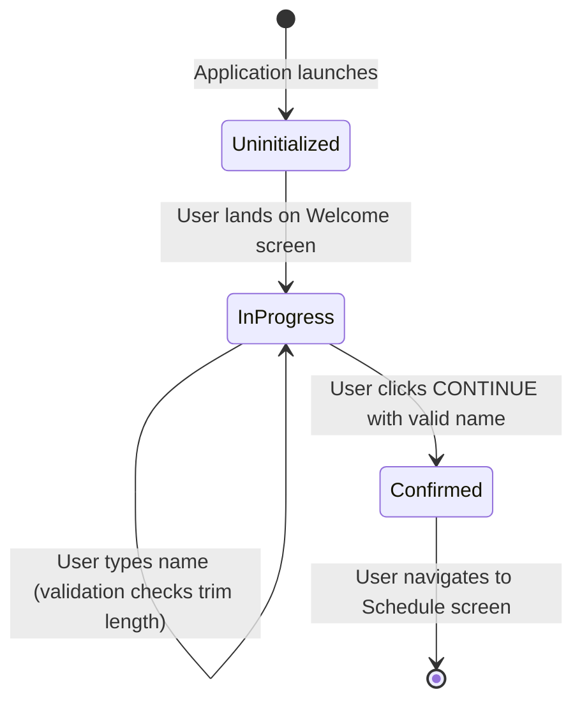

# Data Model: Start, Welcome, and Schedule Header Flow

**Feature**: [spec.md](spec.md)  
**Date**: 2026-10-12  

## Overview

This feature operates purely on the client side during the initial onboarding experience. It defines lightweight presentation state models without requiring backend database tables.

## Entities

### 1. UserProfile

Represents the student profile information gathered during the Welcome onboarding step.

| Field | Type | Required | Description | Validation Rules |
|---|---|---|---|---|
| `displayName` | `string` | Yes | Student display name entered on the Welcome page. | Must contain at least one non-whitespace character (`displayName.trim().length > 0`). Empty string by default. |

#### Lifecycle and State Transitions

### 2. OnboardingStep

Represents the active step and metadata for the 3-step onboarding flow.

| Field | Type | Required | Description | Values |
|---|---|---|---|---|
| `stepNumber` | `number` | Yes | 1-based index of the current onboarding step. | `1` (Start), `2` (Welcome), `3` (Schedule Header) |
| `stepName` | `string` | Yes | Semantic identifier for the step. | `'start'`, `'welcome'`, `'schedule'` |
| `route` | `string` | Yes | Vue Router URL path for the step. | `'/'`, `'/welcome'`, `'/schedule'` |
| `showDots` | `boolean` | Yes | Whether the 3-dot progress bar is rendered. | `false` on step 1, `true` on steps 2 and 3 |
| `activeDotIndex` | `number \| null` | No | 1-based index of the active dot on the progress bar. | `null` on step 1, `2` on step 2, `3` on step 3 |

#### Step Matrix

| Step Number | Route | View Component | Progress Dots Displayed | Active Dot Highlighted |
|---|---|---|---|---|
| 1 | `/` | `StartView.vue` | No | None |
| 2 | `/welcome` | `WelcomeView.vue` | Yes | Dot 2 (Middle) |
| 3 | `/schedule` | `ScheduleView.vue` | Yes | Dot 3 (Right) |
