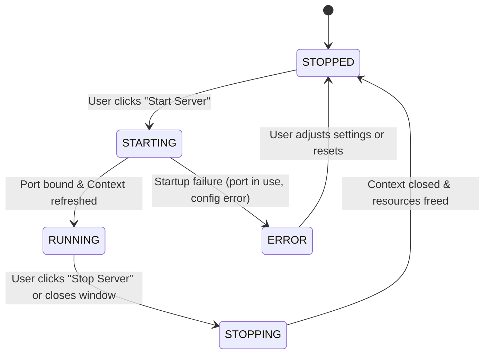

# Data Model: Desktop Swing Launcher and Pre-release Packaging

## Entities

### 1. `LauncherConfig`

Represents the user configuration loaded from and saved to `nyare.properties`.

| Field | Type | Description | Default | Validation |
| :--- | :--- | :--- | :--- | :--- |
| `aiProvider` | String (`enum`) | Active AI engine provider | `google` | Must be `google` or `groq` |
| `googleApiKey` | String | API key for Google Gemini | `""` | Non-null, trimmed string |
| `groqApiKey` | String | API key for Groq Cloud | `""` | Non-null, trimmed string |
| `serverPort` | Integer | Network port for Spring HTTP server | `8080` | Between `1024` and `65535` |
| `browserAutoOpen` | Boolean | Launch default browser on startup | `true` | Valid boolean |
| `observability` | Boolean | Activate the `observability` profile and audit console | `false` | Valid boolean |

#### File Representation (`nyare.properties`)
```properties
# Nyare Server Configuration
# Generated automatically on launch. Edit here or via the launcher GUI.

# AI Provider: 'google' or 'groq'
ai.provider=google

# API Keys
google.api.key=
groq.api.key=

# Server Network Port
server.port=8080

# Automatically open default browser when server starts
browser.auto-open=true

# Enable the dev audit trace console at /dev/observability
observability.enabled=false
```

---

### 2. `ServerState`

Tracks the lifecycle status of the embedded Spring Boot instance.



| State | Status Display | Start Button Text | Open Browser Enabled | Inputs Editable |
| :--- | :--- | :--- | :--- | :--- |
| `STOPPED` | "Status: Stopped" (Gray/Red) | "Start Server" | `false` | `true` |
| `STARTING` | "Status: Starting server..." (Orange) | "Starting..." (Disabled) | `false` | `false` |
| `RUNNING` | "Status: Running at http://localhost:<port>" (Green) | "Stop Server" | `true` | `false` |
| `ERROR` | "Status: Startup Failed" (Red) | "Start Server" | `false` | `true` |

---

### 3. `ConsoleBuffer`

Manages log output captured from `System.out` and `System.err`.

| Attribute | Type | Value |
| :--- | :--- | :--- |
| `maxLines` | Integer | `2000` |
| `trimBatch` | Integer | `500` lines trimmed when buffer exceeds limit |
| `encoding` | Charset | UTF-8 |
| `autoScroll` | Boolean | `true` (caret set to end of document) |
